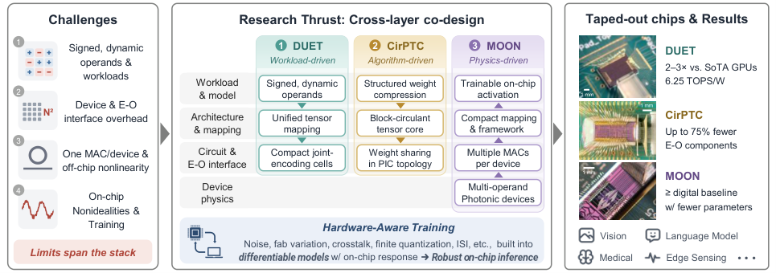
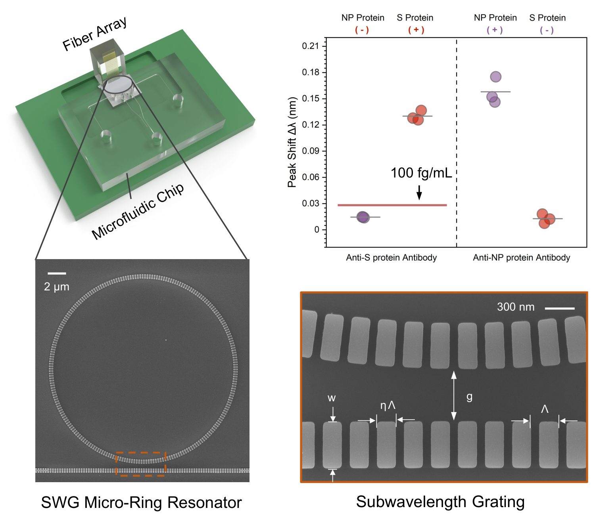
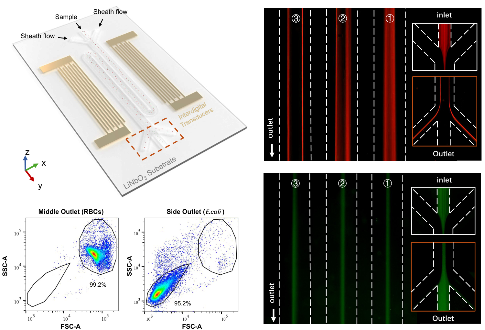

My research harnesses physical interactions through device-system co-design. Across computing and bioanalysis, I seek to turn new physical capabilities into compact, useful systems—from device concepts to fabricated hardware and experimental demonstrations.

<nav class="page-index" aria-label="Research topics"><a href="#photonic-computing">Photonic Computing</a><a href="#integrated-microsystems">Integrated Microsystems</a><a href="#future-research-directions">Future Research Directions</a></nav>

## Photonic Computing

Integrated photonics offers bandwidth, parallelism, and low-latency signal propagation. Realizing these advantages in AI systems requires coordinated choices across device physics, circuit topology, interfaces, architectures, and learning algorithms.

<figure class="research-figure"><figcaption>Three complementary paths to photonic AI hardware: workload-driven, algorithm-driven, and physics-driven design. DUET energy-efficiency and GPU-comparison figures shown here are projections; functional demonstrations use fabricated chips. Click the figure to view at full size.</figcaption></figure>

### General-Purpose Photonic Tensor Operations

The **dynamic universal encoding tensorcore (DUET)** directly processes pairs of signed, dynamic vectors in compact computing cells. Joint encoding and physical-domain accumulation reduce the overhead of separate signed paths and nonlinear operand remapping. A unified tensor-mapping scheme supports diverse AI operators, with on-chip demonstrations covering image classification, medical image segmentation, and attention operations.

[Read the preprint](https://arxiv.org/abs/2605.23051)

### Structured Models, Efficient Hardware

The **block-circulant photonic tensor core (CirPTC)** embeds structured weight sharing directly into photonic circuit topology. Connecting model compression with hardware architecture reduces trainable parameters, active electro-optic components, and memory requirements by up to 75%, with only marginal accuracy loss in the reported experimental tasks.

[Optica, 2025](https://doi.org/10.1364/OPTICA.559604)

### Computing With Intrinsic Device Physics

**Multi-operand optical neurons (MOON)** use independently controlled modulation regions within a single device to combine multiple inputs. Their intrinsic transfer functions provide tunable nonlinear responses. This work explores how device behavior and model training can be designed together, alongside hardware-aware training that accounts for measured responses and implementation nonidealities.

[Nanophotonics, 2024](https://doi.org/10.1515/nanoph-2023-0554) · [CLEO, 2025](https://doi.org/10.1364/CLEO_AT.2025.AA120_1)

## Integrated Microsystems

Compact bioanalytical systems must coordinate sample handling, target interaction, and measurement. My work combines photonics, acoustics, and microfluidics to address these challenges at the device and system levels.

### Multiplexed Photonic Biosensing

I developed a platform that combines **subwavelength-grating microring resonators**, microfluidic sample delivery, and fiber-optic interfaces. By extending the optical mode into analyte-filled gaps, the resonator strengthens light–matter interaction. The reported experiments differentiated SARS-CoV-2 and influenza A H1N1 antigens within 15 minutes without amplification, with a spike-protein detection limit of 100 fg/mL.

<figure class="research-figure compact"><figcaption>Photonic sensing and microfluidic integration for multiplexed antigen detection. Figures from my research materials.</figcaption></figure>

[Applied Physics Reviews, 2023](https://doi.org/10.1063/5.0146079)

### Acoustofluidic Sample Processing

I developed a **serpentine acoustofluidic architecture** that co-designs channel geometry with the pressure nodes of standing surface acoustic waves. Reusing the acoustic field across successive channel segments extends interaction time within a compact footprint. Experiments demonstrated high-throughput separation of bacteria from human blood cells.

<figure class="research-figure compact"><figcaption>Field–structure co-design for compact, high-throughput cell separation.</figcaption></figure>

[Lab on a Chip, 2021](https://doi.org/10.1039/D1LC00840D)

## Future Research Directions

My future research interests include:

- **Heterogeneous Computing Fabrics** that combine optical parallelism, analog electronic processing, and digital programmability.
- **Computing-Native Photonic Devices**, developed through AI-assisted design and experimental feedback.
- **Domain-Specific Photonic Processing** within sensing and communication pathways.
- **Active Bioanalytical Microsystems** that coordinate sample preparation, manipulation, and detection.
- **Coupled Optical–Acoustic Systems** for integrated sensing, actuation, and information processing.

